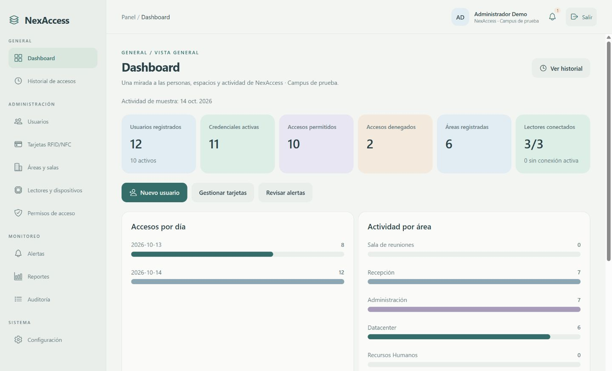

# NexAccess

Sistema de control de accesos físicos y registro de asistencia mediante credenciales RFID/NFC físicas y digitales.

Este repositorio reúne la documentación del proyecto y un prototipo frontend de administración con React Native, Expo y Expo Router.

## Contenido

- [`Documentos/`](Documentos/): documentación y cronograma del proyecto.
- [`SQL/`](SQL/): esquema inicial y documentación de la base de datos.
- [`frontend/`](frontend/): aplicación, tipos, datos ficticios, componentes y pruebas.

## Probar el frontend

Desde un clon del repositorio, seleccionar la rama del frontend:

```bash
git fetch origin
git switch feature/nexaccess-frontend
cd frontend
npm ci
npm run web
```

Si Git no tiene todavía una rama local, `git switch --track origin/feature/nexaccess-frontend` permite crearla explícitamente.

Para probar con Expo Go en el teléfono:

```bash
npx expo start --go
```

Credenciales públicas de demostración: usuario `admin`, contraseña `NexAccess2026!`. No hay registro público de cuentas.

La aplicación incluye Dashboard, Historial de accesos, Usuarios, Tarjetas RFID/NFC, Áreas y salas, Lectores y dispositivos, Permisos de acceso, Alertas, Reportes, Auditoría y Configuración.



## Integración del equipo

Consultar la [guía de integración](frontend/INTEGRACION.md), el [README del frontend](frontend/README.md) y la [evidencia de verificación](frontend/VERIFICACION.md).

El frontend funciona con datos ficticios y estado en memoria. La autenticación real, la API, la persistencia y la comunicación NFC/ESP32 están pendientes de integración. El esquema SQL y la documentación existentes se conservan sin modificaciones en esta rama.
